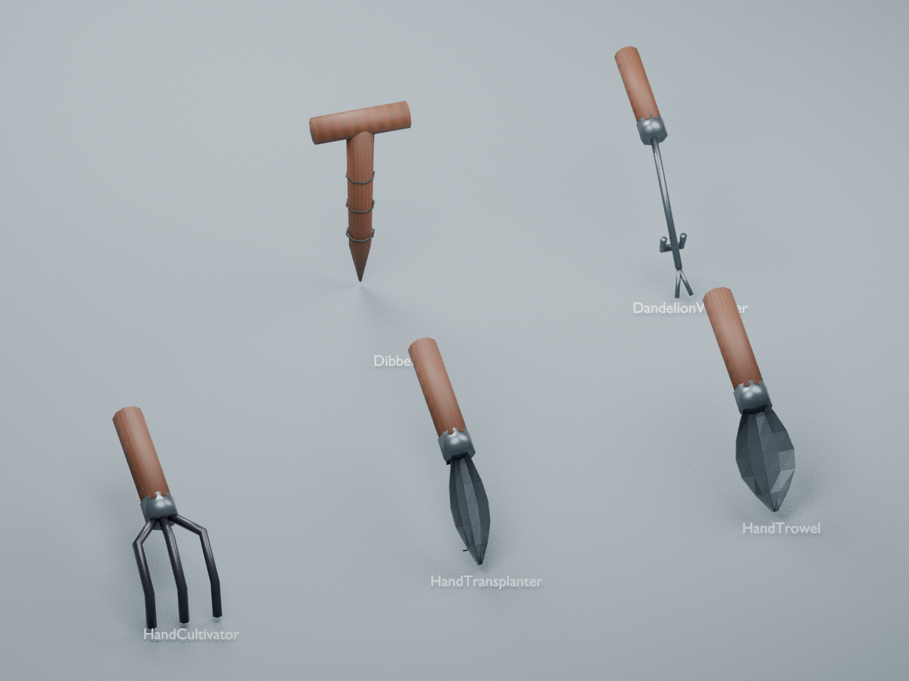
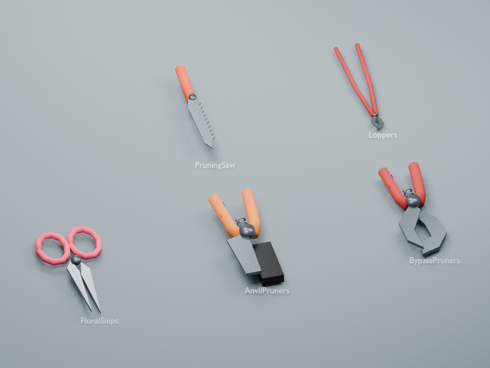
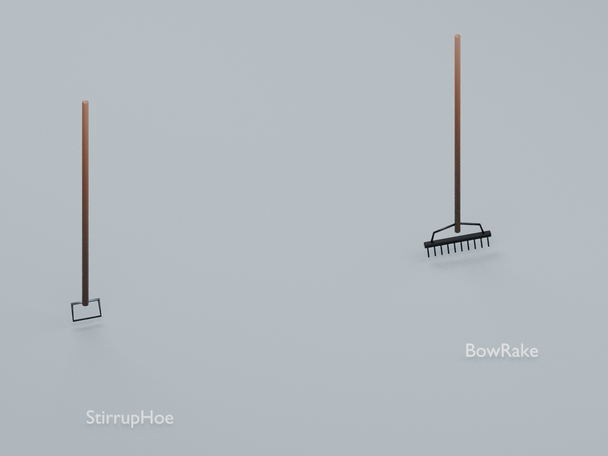
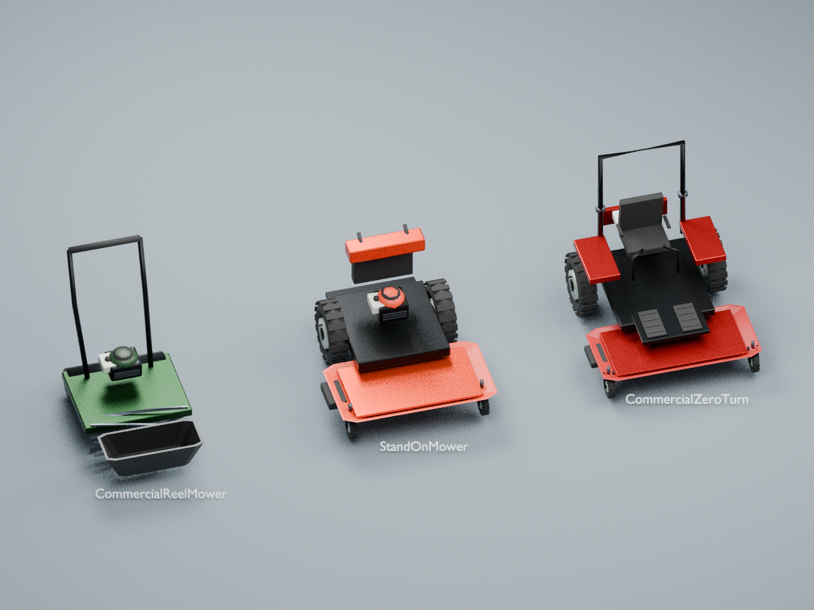
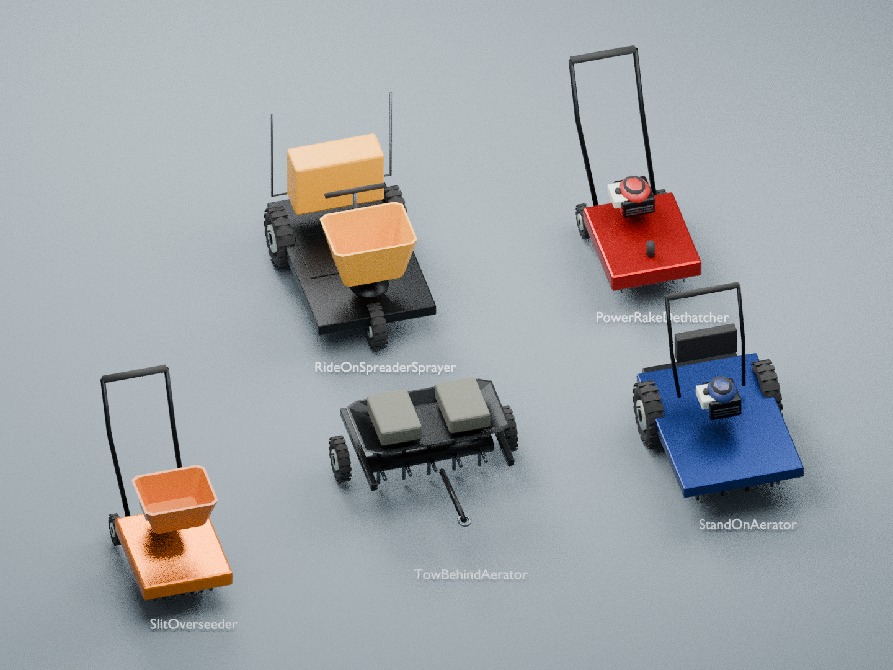
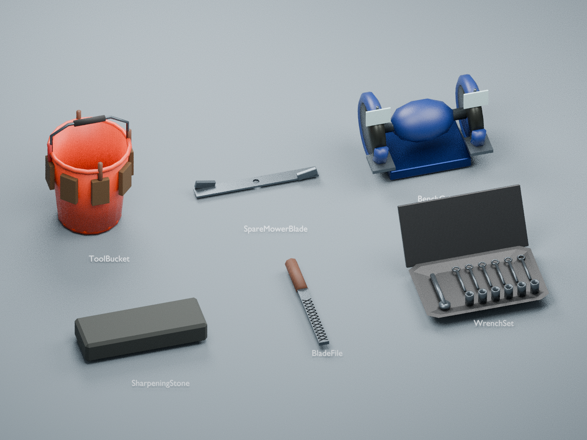
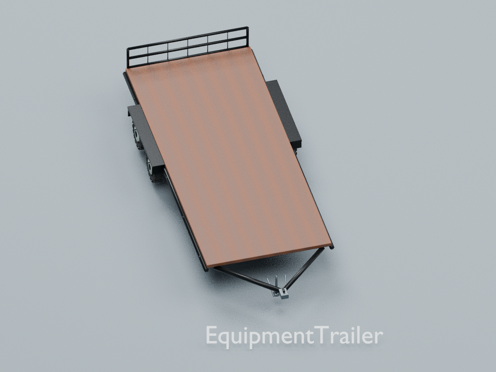
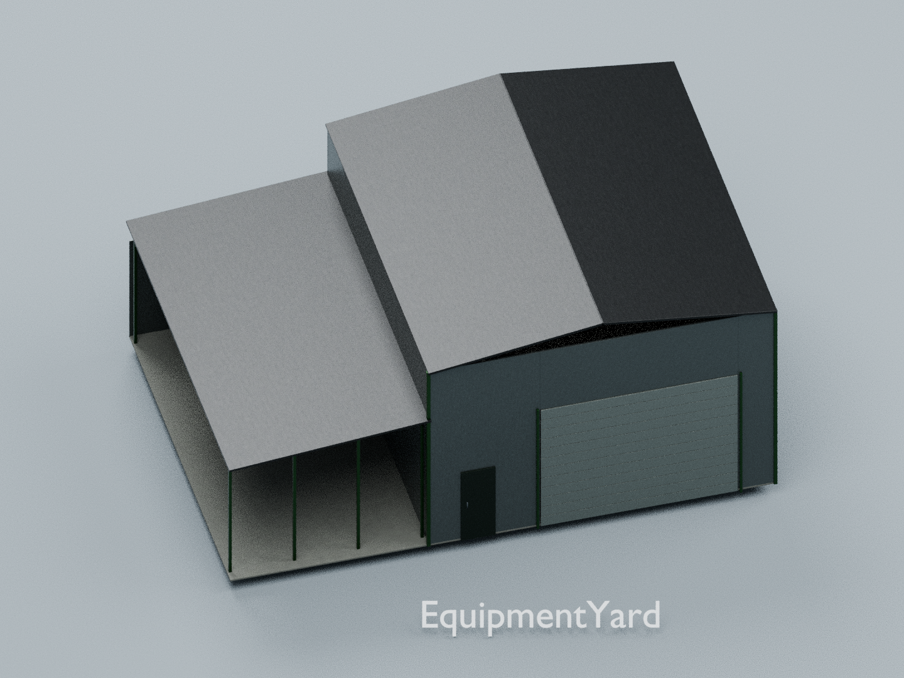

# Model previews

Each picture groups the new models from one instruction file. Items are individually scaled for readability; exact dimensions are in [the catalog](../CATALOG.md).

## Instruction 10

HandTrowel, HandTransplanter, HandCultivator, DandelionWeeder, Dibber

## Instruction 11

BypassPruners, AnvilPruners, FloralSnips, Loppers, PruningSaw

## Instruction 12

GardenHoseWand, WateringCan, NitrileGloves, ChemicalGloves

## Instruction 13

RoundPointShovel, GardenSpade, Broadfork, DiggingFork, Mattock

## Instruction 14

BowRake, StirrupHoe

## Instruction 15

SingleWheelbarrow, SingleWheelbarrowFlatFree, DualWheelbarrow, PolyCart, BroadcastSpreader, BackpackSprayer

## Instruction 16

CommercialZeroTurn, StandOnMower, CommercialReelMower

## Instruction 17

StraightShaftTrimmer, ArticulatingHedgeTrimmer, SoilProbe

## Instruction 18

StandOnAerator, TowBehindAerator, SlitOverseeder, PowerRakeDethatcher, RideOnSpreaderSprayer

## Instruction 19

GasCan, MixGasCan, TrimmerLine, FootPump, ElectricInflator, AirCompressor, TirePatchKit, SpareTire

## Instruction 20

WrenchSet, BladeFile, SharpeningStone, BenchGrinder, SpareMowerBlade, ToolBucket

## Instruction 21

EquipmentTrailer

## Instruction 22

EquipmentYard

## Instruction 23

Workbench, StoragePegboard, StorageWallRack, StorageWallHooks

